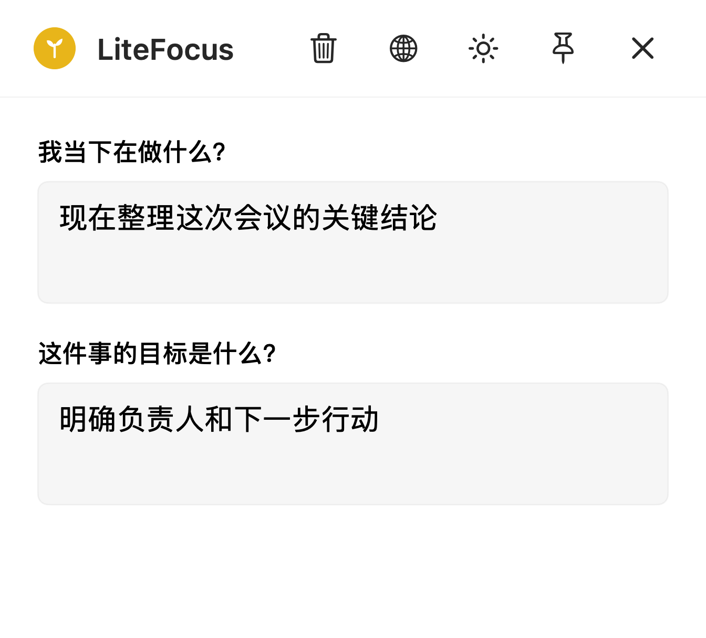
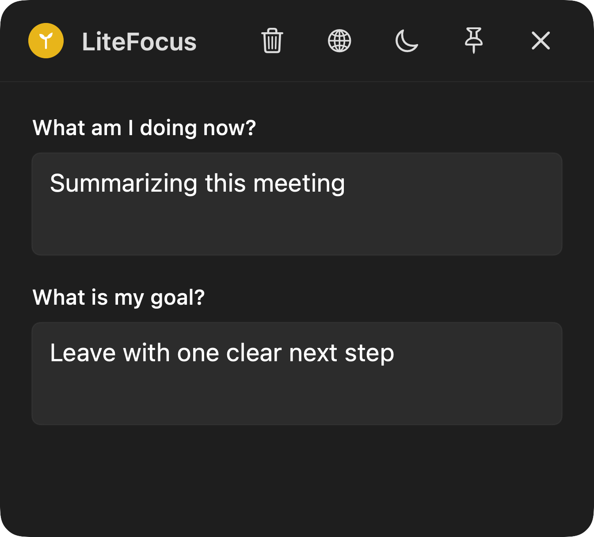

# LiteFocus

**One Focus. One Thing. One Goal.**

LiteFocus 是一款原生 macOS 桌面悬浮工具，始终只保存一件当下正在做的事和这件事的目标。鼠标移到黄色嫩芽悬浮球上即可查看；点击输入框直接编辑，内容实时保存。点击 Clear 可同时清空两个字段，无历史记录。

LiteFocus is a native macOS floating tool for one current activity and one goal. Hover over the yellow sprout ball to view them; click a field once to edit, with immediate local saving. Clear removes both fields, with no history.

### 中文浅色界面

<p align="center"></p>

### English Dark mode

<p align="center"></p>

## 功能 / Features

- 一个事项、一个目标；自由文本和换行；本地自动保存。 / One activity and one goal, multiline text, automatic local saving.
- Hover 展开、移开收起；Pin 固定展开；× 收起并取消 Pin。 / Hover to open and leave to close; Pin keeps the panel open; × closes and unpins it.
- 悬浮球或面板顶部可拖动，悬浮位置按显示器保存。 / Drag the ball or panel header; position is remembered per display.
- 中文/英文界面、浅色/深色外观；原生 SwiftUI + AppKit。 / Chinese and English, Light and Dark, native SwiftUI + AppKit.
- 无多事项、历史、分类、提醒、AI、统计、账户或同步。 / No lists, history, categories, reminders, AI, analytics, accounts, or sync.

## 下载 / Download

[下载最新 macOS 版本 / Download the latest macOS release](https://github.com/victor-zhang-2026/LiteFocus/releases/latest)

macOS 14+ · Apple Silicon (arm64) · 免费开源 / free and open source. 下载 ZIP 和 `SHA256SUMS`，使用 `shasum -a 256 -c SHA256SUMS` 校验。应用使用 ad-hoc 签名，未经 Apple 公证；首次启动可在 Finder 中右键点击应用，选择“打开”。详细步骤与本地数据位置见 [安装与数据](docs/install-and-data.md)。

Download the ZIP and `SHA256SUMS`, then verify with `shasum -a 256 -c SHA256SUMS`. The app is ad-hoc signed and not notarized; on first launch, right-click the app in Finder and choose Open. See [install and data](docs/install-and-data.md) for details.

## 从源码构建 / Build from source

```bash
./scripts/build-app.sh
open build/LiteFocus.app
```

The application has no runtime dependencies. The build script uses the installed macOS 26.5 Command Line Tools SDK where available; set `LITEFOCUS_MACOS_SDK` to an alternate SDK path when needed. `scripts/generate-icon.py` requires Pillow only to regenerate the checked-in icon.

## 数据与隐私 / Data and privacy

内容与设置留在当前 Mac 用户的偏好文件中，纯文本、无自动备份。点击 Clear 会删除两个内容字段。完整边界见 [隐私说明](docs/privacy.md)。

Content and settings stay in the current Mac user's preferences as plaintext, without automatic backup. Clear deletes the two content fields. See [privacy](docs/privacy.md).

MIT License. Copyright © 2026 Victor Zhang.
